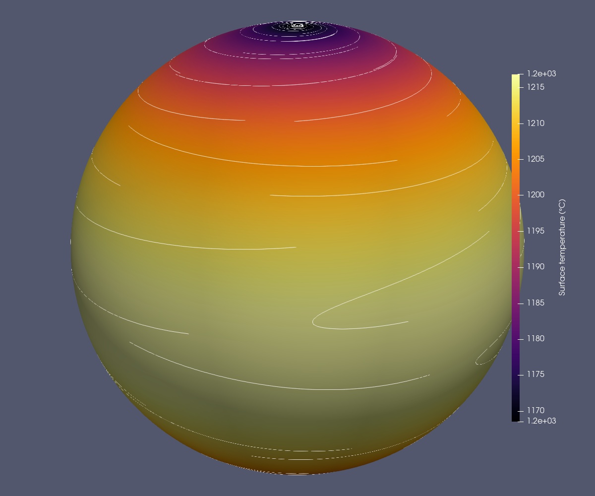

# ATHAD

**Atmosphere of the Earth in the Hadean Eon.**

<p align="center"></p>

<p align="center"><sub>Surface temperature (°C) of the steam atmosphere over the magma ocean, 1168–1217 °C, coolest at the poles; white: surface-wind stream lines; north pole at the top. Arm <code>run_long_tied</code> (Tiedtke convection) at iteration 400, drawn from the level-0 radial slice with <code>literature/hadean_globe.py</code> (outside the repo).</sub></p>

**The Hadean family.** Three successive epochs of the early Earth, one model each, forked from one another with their full history so fixes cherry-pick in both directions:

| Model | Epoch | Atmosphere | Surface |
|---|---|---|---|
| **ATHAD** (this repo) | ~4.4 Ga, over the magma ocean | steam (H₂O-dominated), ~250 bar | molten or quenching rock, no topography |
| [ATHAD_COND](https://github.com/RogerGrundmann/ATHAD_COND) | after the steam rained out | CO₂-dominated, 27–100 bar | liquid sea at 230–250 °C |
| [ATHAD_PERID](https://github.com/RogerGrundmann/ATHAD_PERID) | after a peridotitic magma ocean solidified | CO₂-dominated, 5–20 bar | ocean at 20–150 °C |

**Sister family:** the same ATOM numerics run the giant planets -- [ATJUP](https://github.com/RogerGrundmann/ATJUP), [ATSAT](https://github.com/RogerGrundmann/ATSAT), [ATURAN](https://github.com/RogerGrundmann/ATURAN), [ATNEPT](https://github.com/RogerGrundmann/ATNEPT).

An atmospheric general-circulation model of the Earth at ~4.4 Ga: a finite-difference
Navier–Stokes solver on a spherical shell with RK4 time integration and vertical
coordinate stretching, applied to a ~250 bar, water-vapour-dominated atmosphere over a
molten or quenching surface with no topography.

ATHAD is the atmosphere half of [ATOM_Precipitation](https://github.com/RogerGrundmann/ATOM_Precipitation)
(forked at `1e3f319`) re-based onto Hadean conditions. It keeps that model's turbulence
closures (k-ε, k-ω, k-ω SST), saturation adjustment, Zero/One/Two/Three-Category ice
schemes, moist convection and multi-layer radiation, and replaces everything that was
calibrated to a 1 bar, 288 K, N₂/O₂ Earth.

## Repository layout

```
atmosphere/   C++ source — the atmosphere model
cli/          Command-line interface source and config file
lib/          Shared utilities (arrays, geometry, …)
python/       Python bindings (Cython)
test/         Self-tests
tinyxml2/     Embedded TinyXML-2 XML parser
param.py      Parameter definitions (generates .inc, .pxi and .xml at compile time)
Makefile      Top-level build file
CLAUDE.md     Project constants, invariants and open risks
```

## Prerequisites

| Dependency | Notes |
|---|---|
| g++ ≥ 7 or clang++ ≥ 6 | C++17 required |
| OpenMP | Typically ships with the compiler |
| Cython, Python ≥ 3.6 | Only for the Python interface |

## Build

```bash
make had          # the CLI executable, cli/had
make all          # CLI + Python extension
```

## Run

```bash
cd python && OMP_NUM_THREADS=8 ../cli/had config_athad.xml
```

Output lands in `python/output_Hadean/` as ParaView `.vtk` slices and `.vts`
panoramas — the ATOM line's convention (`output_<name>/`, relative to the run
directory). Run from `cli/` instead and it writes `cli/output_Hadean/`; the
`<output_path>` entry in the config controls it either way.

## Configuration

`cli/config_athad.xml` is generated from `param.py` and carries every parameter with
its default and a description. You need only include the entries you want to change;
everything else falls back to the compiled default.

## Hadean conditions

Surface pressure 250 bar, surface temperature ≈ 1500 K, mean molar mass 21.43 g/mol,
R_mix = 387.9 J/(kg·K), surface density 43 kg/m³. Composition by mole fraction:
80 % H₂O, 10 % CO₂, 3 % N₂, and 1.4 % each of CH₄, NH₃, H₂, CO and SO₂. H₂O and CO₂
are prognostic; the rest are a fixed well-mixed background.

Full constants, the three model invariants, and the assumptions that are still open
are in [CLAUDE.md](CLAUDE.md).

## Status and limitations

Under construction. This section records what has actually been measured — including the measurements that did not work out — rather than what is intended. The numbered items other repositories cite as "ATHAD README item N" are in this section and the next, now in CLAUDE.md.

The full text is in [CLAUDE.md](CLAUDE.md).


## Scope: the anelastic continuity fix

Status: steps 1–7 are implemented and measured (items 16 and 17). Numbered items continue from *Status and limitations*.

The full text is in [CLAUDE.md](CLAUDE.md).


## Remaining work

The prescribed adiabat and the grey opacity are incompatible, and that is now the radiative question (item 73).

The full text is in [CLAUDE.md](CLAUDE.md).

